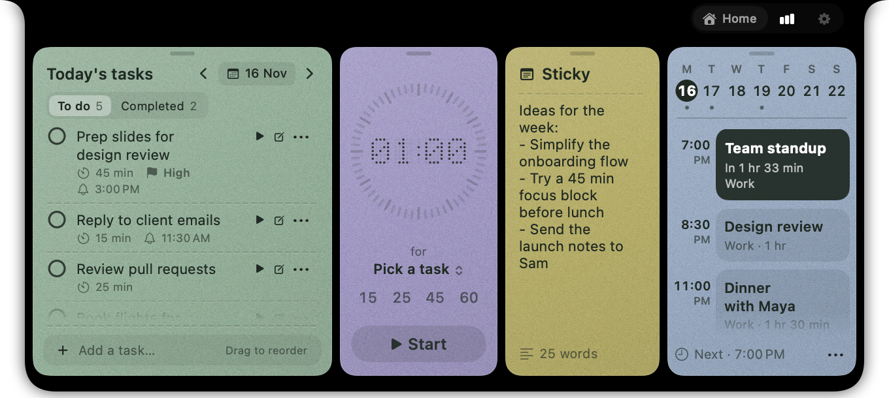
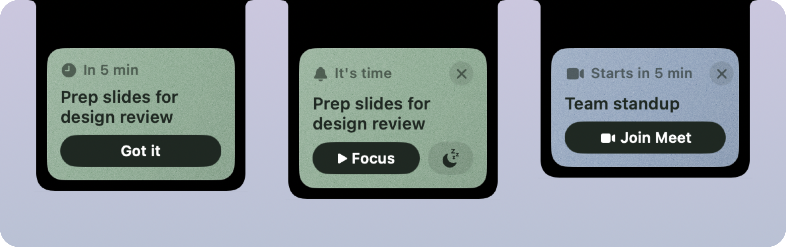
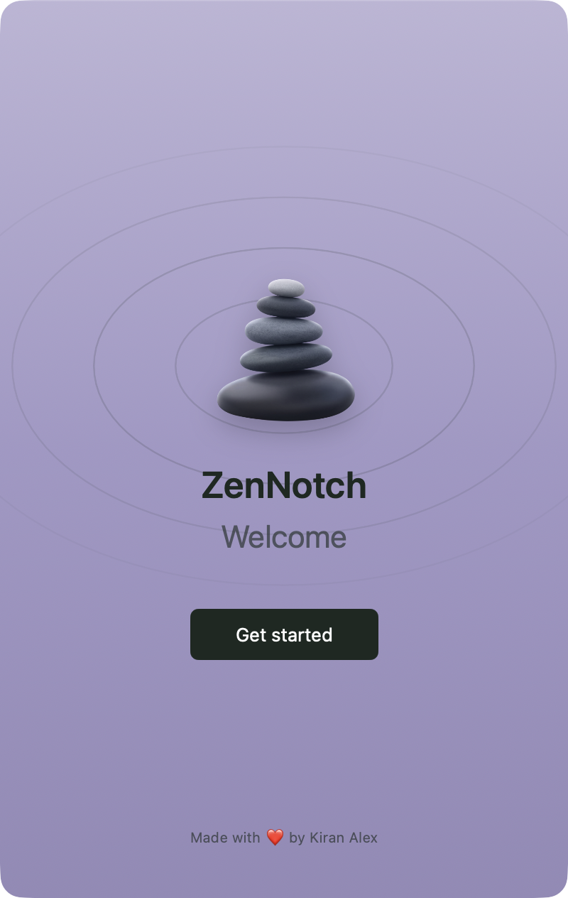

<h1 align="center">
  ZenNotch
</h1>

<p align="center">
  A calm, paper-styled productivity hub that lives in your MacBook's notch.<br/>
  Tasks, focus timer, notes, calendar and insights, one hover away.
</p>

<p align="center">
  <a href="https://app.kiranalex.site/#/app/zennotch"></a>
  <a href="https://discord.gg/5hyMAsBvXr"></a>
  
  
</p>

<p align="center">
  
</p>

## Features

### ✅ Tasks
Your tasks are Apple Reminders, so they sync with iCloud, your iPhone and your Apple Watch.

- **Type naturally.** "Dentist next Friday 3pm" sets the date and time, "Write report for 45 mins" sets how long it takes, and "Pay rent !!!" or "p1" sets the priority. The extra words are removed from the title.
- **Plan each task** from its menu: due date (Today, Tomorrow, Next week or any day), reminder time, duration, priority and list.
- **See what's late.** Overdue tasks are marked in red and stay on today's list.
- **Move through days** with the arrows or a month picker, and switch between **To do** and **Completed**.
- **Drag to reorder** your list.
- **Start a focus session** on any task with its play button.

### ⏱ Focus timer
- 15, 25, 45 or 60 minute sessions, or a task's own duration.
- Link a session to a task, and the time is added to that task.
- While a session runs, the closed notch shows the countdown, so you can keep track without opening it.
- A soft chime and a notification when the session ends.

### 📝 Notepad
- One note per day, saved automatically on your Mac.
- Jump to any day with the month picker. Days with notes are marked.
- A live word count.

### 📅 Events
- A week strip with dots on busy days.
- The current or next event is highlighted with a countdown ("In 1 hr 20 min").
- A **Join** button on the highlighted event for Zoom, Google Meet, Teams, Webex and FaceTime links.
- Timed reminders appear in the timeline, and you can tick them off there.
- Choose which calendars to show from the card's menu.

### 📊 Insights
- Tasks completed against tasks planned, and focus time.
- Ranges of 7 days, 30 days, 3 months, a year or all time, compared with the period before.
- Totals for focus time, active days and your best day.

### 🔔 Task alerts
A small card drops down from the closed notch, so you don't need to open anything.

- **Heads-up** a few minutes before a timed task ("In 5 min"), with **Got it**.
- **When it's time**, a second card with **Focus** to start working and **Snooze** to be reminded later.
- Click the task name to open the notch on that task. It blinks in the list.

### 🎥 Meeting alerts
- A card a few minutes before a meeting, and another when it starts, each with a **Join** button.
- Joining from the first card skips the second one.
- Only events with a meeting link get alerts unless you turn on alerts for all events.

<p align="center">
  
</p>

### 🎨 Design
- Soft paper cards with a grain texture: sage for tasks, lavender for focus, mustard for notes and slate for events.
- Calm alert sounds from Google's Material Design set.
- Text and spacing scale with your screen size.

### ⚙️ Settings
- **Alerts:** turn task and meeting alerts on or off, set the heads-up time, the snooze length, and sound.
- **Cards:** show or hide each card. Drag the handle at the top of a card to reorder them.
- **Behaviour:** open the notch on hover or on click, set the hover delay, haptics, and the keyboard shortcut.
- **Display:** choose which screen, show it on every screen, adjust the notch height, and hide it from screen recordings.
- **Launch at login.**

<p align="center">
  
</p>

## Installation

**Requirements:** macOS 14 Sonoma or later, Apple Silicon or Intel.

1. Download `ZenNotch.zip` from the latest [release](https://github.com/Kiran-Alex/ZenNotch/releases/latest).
2. Unzip it and move **ZenNotch** to your `/Applications` folder.

> [!IMPORTANT]
> ZenNotch is not notarized by Apple yet, so macOS will warn you about an unidentified developer on first launch. You only need to bypass this once.

**Terminal (recommended):**

```bash
xattr -dr com.apple.quarantine "/Applications/ZenNotch.app"
```

**Or System Settings:** try to open the app, click OK, then go to System Settings > Privacy & Security and click **Open Anyway**.

<p align="center">
  
</p>

## Usage

- **Open the notch** by hovering over it, swiping down with two fingers, or pressing `⌘⇧I`. You can switch to click-to-open in Settings.
- **Switch views** with **Home** and **Insights** at the top right. The gear opens Settings.
- **Give access** to Reminders and Calendar when asked. Tasks, events and alerts need it.

## Privacy

- Tasks and events stay in Apple Reminders and Calendar. ZenNotch reads and edits them on your Mac.
- Notes, focus history and settings are stored locally on your Mac.

## Building from source

**Prerequisites:** macOS 15.6 or later and Xcode 26 or later.

```bash
git clone https://github.com/Kiran-Alex/ZenNotch.git
cd ZenNotch
open boringNotch.xcodeproj
```

Before building, select your own team under **Signing & Capabilities** and change the bundle identifier (`site.kiranalex.zennotch`) to one you own. Then press `Cmd + R`.

`scripts/run.sh` builds and launches the app from the terminal.

## Contributing

Contributions are welcome. Read [CONTRIBUTING.md](CONTRIBUTING.md) to get started.

## Community

Join the [Discord server](https://discord.gg/5hyMAsBvXr) for updates and to share feedback.

## Acknowledgments

ZenNotch is based on [Boring Notch](https://github.com/TheBoredTeam/boring.notch) by TheBoredTeam, used under the GPL-3.0 license. Thank you to the authors and maintainers.

Other projects that made this possible:

- **[MediaRemoteAdapter](https://github.com/ungive/mediaremote-adapter)**
- **[NotchDrop](https://github.com/Lakr233/NotchDrop)**

See [THIRD_PARTY_LICENSES](./THIRD_PARTY_LICENSES) for the full list of licenses and attributions.

## License

ZenNotch is released under the [GNU General Public License v3.0](LICENSE).
