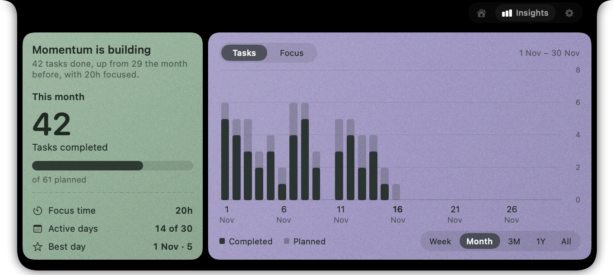

<h1 align="center">
  ZenNotch
</h1>

<p align="center">
  A calm, paper-styled productivity hub that lives in your MacBook's notch.<br/>
  Tasks, focus timer, notes, calendar and insights, one hover away.
</p>

<p align="center">
  <a href="https://discord.gg/5hyMAsBvXr"></a>
  
  
</p>

<p align="center">
  
</p>

## Features

- **Tasks:** a daily list with reminders, durations, overdue tracking and drag to reorder.
- **Focus timer:** start a 15, 25, 45 or 60 minute session on any task.
- **Notepad:** a quick daily scratch note, one page per day.
- **Events:** your calendar and reminders for the week, right next to your tasks.
- **Insights:** completed vs planned tasks and focus time over 7 days, 30 days, 3 months, a year or all time.
- **Paper look:** soft, grainy cards in sage, lavender, mustard and slate that stay out of your way.

<p align="center">
  
</p>

## Installation

**Requirements:** macOS 14 Sonoma or later, Apple Silicon or Intel.

1. Download the latest `.dmg` from the [Releases](https://github.com/Kiran-Alex/ZenNotch/releases) page.
2. Open it and move **ZenNotch** to your `/Applications` folder.

> [!IMPORTANT]
> ZenNotch is not notarized by Apple yet, so macOS will warn you about an unidentified developer on first launch. You only need to bypass this once.

**Terminal (recommended):**

```bash
xattr -dr com.apple.quarantine "/Applications/ZenNotch.app"
```

**Or System Settings:** try to open the app, click OK, then go to System Settings > Privacy & Security and click **Open Anyway**.

<p align="center">
  
</p>

## Usage

- Launch ZenNotch and hover over the notch to open it.
- Switch between **Home** and **Insights** with the buttons at the top right.
- Open the gear icon for settings.

## Building from source

**Prerequisites:** macOS 15.6 or later and Xcode 26 or later.

```bash
git clone https://github.com/Kiran-Alex/ZenNotch.git
cd ZenNotch
open boringNotch.xcodeproj
```

Before building, select your own team under **Signing & Capabilities** and change the bundle identifier (`site.kiranalex.zennotch`) to one you own. Then press `Cmd + R`.

`scripts/run.sh` builds and launches the app from the terminal.

## Contributing

Contributions are welcome. Read [CONTRIBUTING.md](CONTRIBUTING.md) to get started.

## Community

Join the [Discord server](https://discord.gg/5hyMAsBvXr) for updates and to share feedback.

## Acknowledgments

ZenNotch is based on [Boring Notch](https://github.com/TheBoredTeam/boring.notch) by TheBoredTeam, used under the GPL-3.0 license. Thank you to the authors and maintainers.

Other projects that made this possible:

- **[MediaRemoteAdapter](https://github.com/ungive/mediaremote-adapter)**
- **[NotchDrop](https://github.com/Lakr233/NotchDrop)**

See [THIRD_PARTY_LICENSES](./THIRD_PARTY_LICENSES) for the full list of licenses and attributions.

## License

ZenNotch is released under the [GNU General Public License v3.0](LICENSE).
